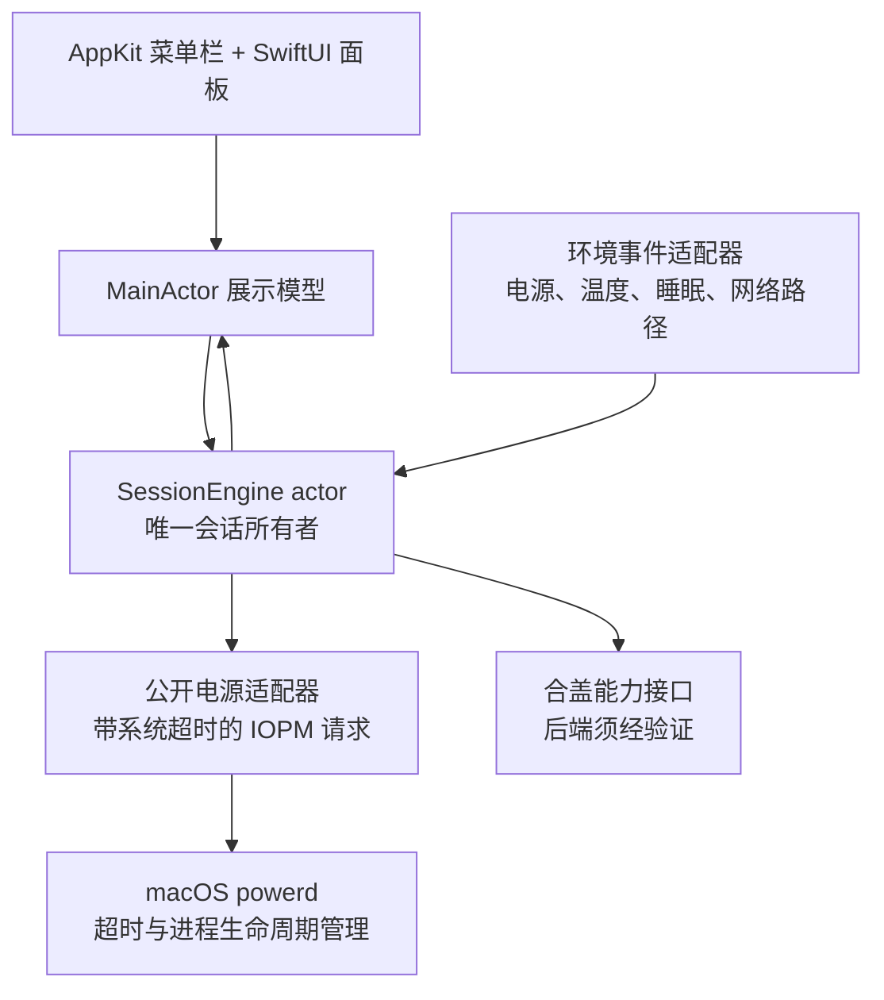

# KeepOnline 架构复核与修订 3.0

日期：2026-10-26。取代此前 2.0 方案。

用户要求保持不变：GitHub 开源；电池供电、无外屏时也要支持合盖运行；只做原生菜单栏工具；开启鲜红色、关闭灰色；简单、安全、适合开发者。

**结论：撤回“全局 disablesleep + root 守护进程”作为已定产品后端。** 上版把一个没有独占所有权、没有自动失效语义的全局开关，包装成了应用自己的会话资源；恢复日志与守护进程不能补出系统没有提供的资源语义。

可确定的架构改为：单个无特权菜单栏进程、单一会话所有者、系统托管的限时电源请求、可替换的合盖能力适配层。电池合盖的后端仍需先完成可行性验证；它是完整产品的发布门槛，不能用只完成普通模式冒充已满足全部需求。

## 1. 上版需要撤回的技术判断

### 1.1 全局开关不是只控制合盖

Apple XNU 开源实现中的 checkSystemSleepAllowed 先检查 userDisabledAllSleep 并返回，后面才处理低电量和温度异常的睡眠放行。因此不能声称“使用 disablesleep 但不影响正常系统保护睡眠路径”。独立温度监控无法在监控进程失效时替代内核机制。

这是对已检查的 Apple 开源实现的结论，不是对本机全部内核和固件保护的证明；更不能推导成所有温度保护或硬件关机都会失效。它已足以否决把该全局开关视为安全的默认产品机制。

### 1.2 日志与心跳不能创造所有权

先读 false、再写 true 存在竞争；后来其他工具也需要同一个 true 时，退出写 false 会覆盖对方意图。没有 compare-and-swap、持有者标识或系统租约，就不能证明“只恢复本工具的状态”。持久化恢复记录还扩大了跨进程与跨重启误恢复的窗口。

### 1.3 未文档化 selector 不是已证实的替代

所查 RootDomainUserClient 的 selector 12 修改与 powerd 共用的合盖位；clientClose 不包含配对清理。聚合的 AppleClamshellCausesSleep 属性既不是本工具的资源凭证，也不能证明该位已即时更新。

IOPMAssertionCreateWithProperties 接受字典不代表所有字典键都是公开能力。所查 powerd 明确对 AppliesOnLidClose 与 AppliesToLimitedPower 要求专用 entitlement，不能把私有键写成普通第三方可用接口。

### 1.4 先加服务和任意限额是倒置设计

root helper、XPC、审批、公证、恢复数据库、升级与卸载流程，都由上述后端带来。它们不应在机制可行性确定前成为必需架构。此前 2/8 小时硬上限、15 秒环境失读等数值也没有测量依据，撤回为已定规则。

## 2. 可确定的核心架构

### 进程与权限

- 正式核心仅一个用户进程，无 root 服务，无系统全局偏好写入，无恢复数据库；默认不安装任何后台组件。
- AppKit NSStatusItem 确保红色／灰色图标和文字；SwiftUI 提供小型 NSPopover。界面不调用系统写入接口。
- SessionEngine actor 拥有会话、请求标识和截止时间，串行处理用户操作与系统事件；MainActor 只展示不可变快照。
- 登录启动按用户选择调用 SMAppService.mainApp，不为登录启动另建 LaunchAgent。
- 继续采用 MIT 开源、原生 Swift、无 CLI。标准核心使用公开 API，可在无付费发布身份时从源码构建测试；正式下载包另做签名公证。

### 电源请求由系统管理有效期

- 使用 IOPMAssertionCreateWithProperties：普通请求为 PreventUserIdleSystemSleep，磁盘请求为可选的 PreventDiskIdle；磁盘默认关闭。
- 每个请求设置 TimeoutSeconds 和 TimeoutActionRelease。到期由 powerd 释放，不依赖本应用计时器执行清理。
- 正常运行时采取短期可续期请求：初始工程参数为 90 秒有效期、每 30 秒续期。实际超时为 90 秒与用户会话剩余时长中较短者；这些是待能耗及稳定性测试调校的参数，不是实时保证。
- 续期触发必须经过健康的 MainActor，再进入 Engine。主线程或 Engine 卡住时不由另一条独立线程持续续期。
- 选择 Release 而非 TurnOff：到期标识被销毁，延迟到达的续期不能重新激活旧请求；必须处理实际返回错误，不能只识别文档中的 notFound。Engine 检测过期后结束会话；不会自动创建新请求掩盖故障。
- 重复点击不叠加请求，旧会话标识不能操作新会话。结束主动释放；进程退出也由系统回收；系统到期后允许清理操作返回对应的失效标识错误。
- 不设置 PreventSystemSleep、显示器保持亮起或伪造用户输入，不用持续磁盘读写和网络请求保活。

这使普通模式的失败策略建立在系统资源到期上，而不是依赖自建看门狗。系统电源请求仍服从系统策略；请求被接受不等于保证电脑在任意条件下持续唤醒。

### 状态与接口

核心最小接口为 start(request)、stop(sessionID)、snapshot；合盖接口为 capabilities、acquire、release。请求成功后返回可释放的 opaque handle，不暴露任意命令执行入口。

- SessionRequest：能力集合、会话截止时间；普通防休眠必选，磁盘可选，合盖只在已验证条件下可请求。
- SessionSnapshot：desired、granted、unsupported、unknown 分开记录，附会话标识、有效期和原因；不把“设置成功”或一个聚合布尔值当作合盖有效证明。
- 生命周期：idle → acquiring → active → releasing → idle；失败保留仍生效的资源信息。正常过程中的网络路径变化不自动结束或重开防休眠。
- 会话 UUID／generation 校验与实际 IOPM 调用必须在同一串行执行段完成；不把裸 IOPM ID 发往异步队列。系统标识可能复用，不能靠旧 ID 自身隔离新会话；恢复后的积压续期事件也必须先核对本地单调截止时间。
- PowerHandle 只由 Engine 持有。普通和磁盘请求若未全部取得，回滚本次新增资源；续期只有 kIOReturnSuccess 且实际状态仍有效时才能继续；失败结束该会话，禁止后台无限重试重新创建。所有错误都保留原始错误码；BadArgument 若出现在期限内则记为后端失败，不能一律掩盖成正常到期。
- 采用 ContinuousClock 表达应用截止时间，并核对睡眠唤醒后的系统实际请求状态；不依赖墙上时间倒计时。

## 3. 电池合盖：先证明机制，再确定进程拓扑

### 当前事实

没有找到已经确认可供普通第三方使用、同时具有公开稳定合同、进程所有权和自动回收语义的“电池无外屏合盖租约”。因此，电池合盖仍是未解决的关键技术项，不是已经有安全实现、只差写代码。

能力接口区分：supported(经过测试的条件)、unsupported、notValidated。当前未经验证的合盖适配器返回 notValidated，界面说明验证状态，不能提供假成功开关。

### 验证顺序

1. 比较候选机制的作用范围、权限、持久化行为、是否影响手动睡眠与保护性睡眠。
2. 优先研究只影响运行期 lid 行为的方式；未文档化 IOKit 路线仅在独立研究目标中验证，不自动进入产品，不作为 public API 宣传。
3. 核验本机以及计划支持的确切 OS build／硬件；Apple GitHub main 源码只用于提出风险和假设，不代表本机二进制合同。
4. 验证进程正常退出、挂起、强制退出、控制组件崩溃、powerd 重启，以及其他软件修改合盖状态时的行为。
5. 只有研究证明需要且确能改善某项清理能力时，再决定是否加入普通用户级恢复组件；不预先承诺 guardian，更不因“合盖功能”就预先引入 root daemon。
6. 不提供全局 disablesleep 的自动降级。失败显示不支持或未验证，不能偷偷换成影响更大的机制。

### 后端进入产品必须回答的问题

| 条件 | 要求 |
| --- | --- |
| 电池无外屏合盖 | 真实 MacBook 持续任务验证，不以属性值或返回码代替 |
| 作用范围 | 能明确区分阻止 lid sleep 与系统全局禁用睡眠 |
| 生命周期 | 能说明每一类退出／挂起后何时回收、由谁回收，以及无法保证的情况 |
| 系统保护 | 不依赖应用轮询来替代正常低电量和温度保护睡眠路径 |
| 并存与所有权 | 不将共享位的“恢复原值”误写为独占租约；无法安全并存须拒绝开启或明确限制 |
| 可观测性 | 不把陈旧或聚合属性当作本工具持有能力的证明 |
| 开源可复现 | 不要求普通贡献者取得不对外开放的 Apple entitlement |

如果这些条件无法满足，应如实报告需求与平台边界的冲突，并重新讨论合盖能力的发布范围。架构设计不能承诺尚未证明的系统能力。仅发布普通模式，不能算完成用户要求的完整工具。

## 4. 简单的产品行为与测试

### 界面和策略

菜单栏：鲜红色表示本工具已取得且未过期的防休眠请求；灰色表示本工具关闭；橙色表示能力获取、释放失败或资源状态无法确认。另有状态文字和辅助功能标签，不靠颜色单独传递含义。不能把红色“保持中”写成“保证网络在线”。

面板只显示开始／结束、剩余时长、合盖能力及折叠的磁盘选项。默认 1 小时，可选 30 分钟、1 小时、2 小时和手动结束；手动结束仍续用系统短期有效请求。磁盘活跃和登录启动默认关闭。不扫描构建进程，不增加远程服务、脚本或 CLI。

电池停止阈值默认 20%，只控制本工具是否继续请求；不宣称该数值是 Apple 硬件安全界限。serious 表示系统热压力，提示用户；critical 时放弃本工具请求。不能把 serious 等同危险绝对温度，也不能把“检测到 critical 再停”当成系统保护的替代。

环境信息优先由事件提供，续期时取必要快照；网络只通过 NWPathMonitor 观察可用路径。标准模式保持系统原生睡眠决定权，环境数据缺失不靠开启全局开关补救。

### 验证重点

- 无系统依赖测试 Engine 状态、单调截止、重复操作、过期回调、续期失败和停止原因。
- 实测 CreateWithProperties、系统超时、旧标识续期失败、SIGSTOP、SIGKILL、锁屏、睡眠和唤醒。
- 证明超时后不会自动重开；普通和磁盘请求分别确认，不能用其中一项成功代替另一项。
- 低电量与温度策略用可控输入测试；实际硬件只做正常运行验证，不主动制造过热或耗尽电池。
- 电池合盖研究有独立的实机矩阵；全部关键性质通过才确定并实现产品后端。
- 测量空闲 CPU、定时唤醒与能耗。无应用层网络心跳、无定时磁盘写入、无周期子进程。

### 架构设计时的验证

本机 macOS 26.4（25E246），使用公开 IOPM 请求，设置 4 秒 TimeoutActionRelease。正常续期成功；测试进程被 SIGSTOP 挂起后，系统仍释放请求；恢复测试进程后对过期旧标识续期返回 kIOReturnBadArgument（-536870206），请求没有重建。Apple 所查实现中 lookupAssertion 对失效 ID 可返回此错误，不能仅依据公共头文件中的 notFound 描述设计错误分支。未修改全局电源设置。

该测试证明此机器上的普通防休眠系统超时与旧标识失效行为，不证明 90/30 秒参数、磁盘请求或电池合盖已经通过完整验收。实现阶段新增的磁盘请求、应用启动和退出等验证，见 [验证记录](Verification.md)。

## 5. 工程与交付决定

核心保持一个应用目标和一个可测试 Swift Package；合盖研究使用独立、不进入默认发布包的研究目标。没有证据需要额外进程前，不增加 LaunchDaemon、LaunchAgent、XPC root 协议或恢复数据库。

GitHub 开源提供架构决策、接口依据、实机兼容性矩阵和可复现测试。主分支构建不需要维护者私钥；发布版单独签名公证，CI 不向外部分支暴露凭据。若今后确有扩展组件，fork 的应用、服务和存储命名空间须一起隔离，不能只改 Team ID。

早期 1.1 原型使用过旧合盖实现，不作为本仓库的发布产物。当前 2.0 系列预览版已按本文的 3.0 架构重写普通防休眠能力，合盖功能保持不可用。此前 2.0 架构草案里的 root daemon、全局开关和补偿日志不再是推荐实现。

### 一手依据

- [Apple IOPMLib.h：系统超时与释放行为](https://github.com/apple-oss-distributions/IOKitUser/blob/main/pwr_mgt.subproj/IOPMLib.h#L734)。
- [Apple XNU：睡眠判断中全局开关与低电量／热状态的顺序](https://github.com/apple-oss-distributions/xnu/blob/main/iokit/Kernel/IOPMrootDomain.cpp#L7098)。
- [Apple powerd：合盖及电池私有属性的 entitlement 检查](https://github.com/apple-oss-distributions/PowerManagement/blob/main/pmconfigd/PMAssertions.c#L2326)。
- [Apple RootDomainUserClient：clientClose 与共享合盖 selector](https://github.com/apple-oss-distributions/xnu/blob/main/iokit/Kernel/RootDomainUserClient.cpp#L250)。
- [Apple SMAppService](https://developer.apple.com/documentation/servicemanagement/smappservice) 及本机 SDK 对签名、公证与后台服务生命周期的说明。

上述 Apple 开源引用用于技术审查；main 分支并非本机运行代码的逐字证明。工程参数与模块边界是本次设计选择，平台限制与实测结果单独列出。
